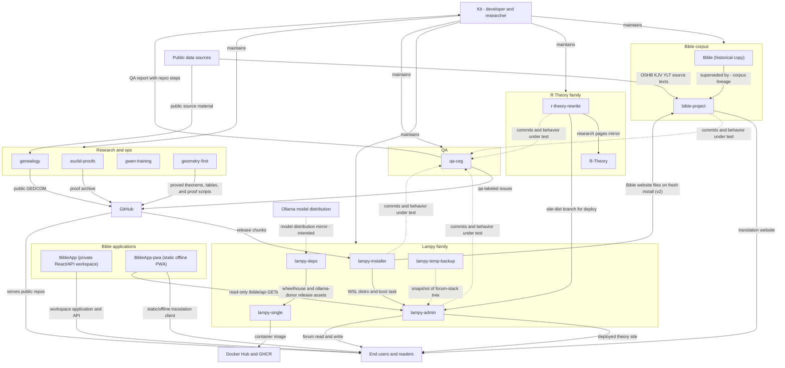
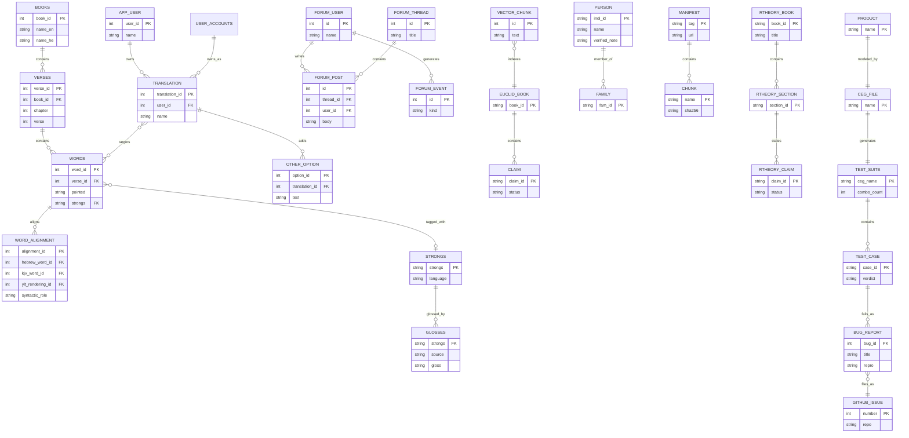

Living document — update these diagrams when adding features.

# cosbykit-afk — System-wide architecture

Profile-level view of the 18-repository `kitcosby` ecosystem as inventoried on 2026-11-04: how
research, applications, infrastructure, and external services relate. Repository roles are not
interchangeable: mirrors, historical snapshots, distinct deployment targets, and separate proof
corpora remain identified as such.

Repo families: **Bible corpus** (Bible, bible-project), **Bible applications** (BibleApp, BibleApp-pwa),
**R Theory** (r-theory-rewrite, R-Theory, rtheory-), **Lampy** (lampy-installer, lampy-admin,
lampy-single, lampy-deps, lampy-temp-backup), **QA** (qa-ceg), and **Research/ops**
(euclid-proofs, genealogy, gwen-training, geometry-first). `cosbykit-afk` holds this ecosystem documentation.

**2026-10-24 revision:** geometry-first is a NEW repository (created 2026-10-08) — the
geometry-first unification corpus (only PROVED/CHECKED results, a clean break from E8),
added to the Research family below; it has no `docs/architecture.md` yet, and whether it
joins the maintained-diagram set is Kit's decision (flagged in the 2026-10-24 run).
Also updated: the bible-project website's PostgreSQL migration and variants campaign,
the lampy-admin Windows dashboard, and lampy-installer v2 (including its new
installer → bible-project Bible-website fetch).

## 1. System-wide context diagram

The repository subsystems, with external entities and the data flows between them.
Dotted flows are intended or not-directly-observed links (see Grounding notes).

## 2. Systemwide database documentation

### 2a. Data store inventory

| Store | Owning repo(s) | Key entities | Notes |
|---|---|---|---|
| bible.db (SQLite, read-only) | bible | 11 corpus tables, 264217 words | Frozen v1 corpus; superseded by bible-project |
| bible_v2.db (SQLite, build corpus) | bible-project | 24 normalized tables, 264217 words, plus witness_verses and verse_notes | v2 schema: books, verses, words, strongs (+components, sources), morph patterns/segments, root tiers, lexicon + 4 child tables, glosses, kjv_words, kjv_renderings, ylt_verses, ylt_renderings, word_alignment, word_variants, morph_variants. The variant builders write this file; the website no longer reads it directly (see the PostgreSQL rows) |
| bible (PostgreSQL) | bible-project website | corpus tables, word_variants (textual), witness_verses, verse_notes | Live corpus since the 2026-10-09 PostgreSQL migration; variants and verse-scale witness data synced from bible_v2.db by export_sync.py |
| bible_app (PostgreSQL) | bible-project website | app_user, translation (with owner_id), other_option, user_accounts, lemma_default, word_choice, reading_position | Website writes; corpus stays read-only. word_choice (2026-10-09) replaced the user_data choice byte files |
| Derived alignment/variant rows | bible-project | word_alignment, word_variants (spelling + textual: MT Kethiv/Qere, SP, DSS witnesses), morph_variants 28 rows | Derived-data stage output; textual variants added by the Oct 14–17 campaign (Kethiv/Qere, Samaritan, Dead Sea Scrolls; Syriac is verse-scale only) |
| Forum database | lampy-admin (forum app) | users, categories, threads, posts, forum_events, docs, forum_daily, mail_user_roles | Console borrows forum users table for auth |
| Euclid vectors SQLite | euclid-proofs | 606 Elements chunks, FTS5 index | Embedded via Ollama for lookup |
| Claim ledger files | euclid-proofs | 493 proved, 79 checked, 209 asserted, 32 incomplete | Per-book claim files under trig_proof |
| Public GEDCOM | genealogy | persons, families | Verified-only copy; private working file not published |
| Change ledger | genealogy | applied research proposals | Two-track admission rulebook in verified/VERIFIED.md |
| Installer manifest | lampy-installer | manifest.json v2.0.0, 14 chunks (file key, derived tarball), install log | No persistent runtime data model; v2 installer also builds PostgreSQL from source, sets up the forum database, and fetches the Bible website from bible-project |
| Windows dashboard state | lampy-admin | none (in-memory HTTP serving) | lampy-admin-win.ps1 (2026-10-13): Windows-side dashboard on 127.0.0.1:8899, commands via wsl.exe, psql via the distro; owns no database |
| Theorem and table files | geometry-first | 27 PROVED theorems (theorems/INDEX.md), validated tables, Sage proof scripts, Pascal layer | No database; only PROVED/CHECKED content, clean break from E8 (created 2026-10-08) |
| BibleApp workspace | BibleApp (private) | React/Vite translation client, API server, generated API client, mockup sandbox | Separate workspace monorepo; live deployment and database wiring not verified in this audit |\n| BibleApp static PWA | BibleApp-pwa | Browser-local rendering choices; service-worker caches for app shell and successful JSON API responses | Static/offline client; GET-only `/bible/api` integration documented in its README |\n| Document tree | r-theory-rewrite | books, sections, figures, claims | Static site source; structure modeled, no database |
| Research mirror files | R-Theory | 3 HTML pages, 6 CSV/JSON tables | Backup mirror of r-theory-rewrite research pages |
| Build context | lampy-single | Dockerfile, supervisord conf, forum source | Produces container image; no runtime data |
| Dependency release assets | lampy-deps | build-deps-v1 release: 7 assets (~7.8 GiB) | wheelhouse.tar.part00-02 + ollama-donor.tar.part00-03; git tree holds only README + docs |
| Code snapshot | lampy-temp-backup | 108 tracked files on 2026-11-04, including control-plane, DB-console, payments, installer, and legacy modules | Historical snapshot; substantial unique material remains to be reviewed before any archival decision |
| Curriculum docs | gwen-training | lesson plan, lessons, prompts | No persistent data model |
| CEG model files | qa-ceg | ceg/*.ceg graphs: inputs, effects, requirements | One graph per product: r-theory-rewrite, forum, lampy-installer, bible-project, profile |
| Generated test suites | qa-ceg | suites/*.tests.md (published), *.tests.json (private) | ceg.py enumerates all combos; exit code = uncovered requirement count |
| Bug database and ledger | qa-ceg | bugs.db (private), PRIVATE_LEDGER.md (private export) | Two-way sync with GitHub qa-labeled issues |

### 2b. Cross-system entity relationships

Key entities per database and how they relate within and across systems.

The bible-project corpus entities above are schema-exact (v2, `schema_v2.sql`).
Remaining entities are representative except where a repo draft documents them
(bible-project website tables, forum tables, genealogy GEDCOM entities,
qa-ceg model entities).

Cross-database links (by design, not by foreign key):
- `TRANSLATION.targets -> WORDS`: the bible-project website writes user
  translations against the read-only corpus. Since 2026-10-09 the corpus
  lives in the PostgreSQL `bible` database and website data in the
  PostgreSQL `bible_app` database; per-word choices are `word_choice` rows
  (sparse, absent = choice 0), not byte files.
- `lampy-installer -> bible-project`: since installer v2.0.0 (2026-10-07/10),
  a fresh install fetches the current Bible website files (`app_v2.py`,
  `papyrus-tile.png`) from `kitcosby/bible-project` (master, website/)
  into the distro — the installer now depends on bible-project, not only
  on its own release chunks.
- `geometry-first` stands apart from the R Theory family by design: it is
  the clean-break, proved-only corpus (native operators, no E8) and does
  not feed r-theory-rewrite; the trigonometry/manuscript audit continues
  in r-theory-rewrite separately.
- `bible.bible.db -> bible-project.bible_v2.db`: lineage only. The bible copy
  is the frozen v1 corpus and superseded; bible-project rebuilt it, extended
  it (U-8/U-9 repairs, YLT alignment, Flask website), and normalized it to
  the v2 schema. The v1 `bible.db` is retained as a frozen baseline; the live
  website serves v2 since the 2026-09-28 cutover (verified live then).
- `FORUM_USER` is shared: lampy-admin's console authenticates against the
  forum's users table rather than keeping its own account store.
- `r-theory-rewrite -> lampy-admin`: the console pulls the site-dist branch and
  deploys the static theory site; no shared database involved.
- `qa-ceg -> GitHub issues`: the QA system files `qa`-labeled bug reports on
  r-theory-rewrite, lampy-installer, bible-project, and qa-ceg itself
  (forum/profile are ledger-only, no repo); a private `bugs.db` stays synced
  two-way with GitHub.

## Grounding notes

- OBSERVED: every repo's purpose, file tree, and README-derived flows come from
  the per-repo drafts in ~/workspace/sad-docs/drafts/, each researched via the
  GitHub API (README + recursive tree + key files).
- OBSERVED: installer release chunks from GitHub; installer creates the WSL
  distro that lampy-admin runs inside; admin pulls r-theory-rewrite site-dist;
  R-Theory is a declared backup mirror of r-theory-rewrite research pages;
  bible is declared superseded by bible-project.
- OBSERVED (2026-09-28): lampy-deps now carries the `build-deps-v1` release
  (7 assets, ~7.8 GiB: wheelhouse.tar.part00-02 + ollama-donor.tar.part00-03,
  created 2026-09-27) that supplies the lampy-single build — the
  deps→single flow is drawn solid. The Ollama distribution→deps mirror flow
  remains INFERRED (wheels/binaries reached the release via staging scripts,
  not a direct upstream transfer); no files are committed to the lampy-deps
  git tree itself (README + docs only).
- INFERRED: the tempbackup -> admin restore direction. The repo is a verified
  snapshot of the forum-stack tree; no restore procedure was observed.
- INFERRED: exact table and key names in the systemwide ERD are representative,
  not schema-exact, except where a repo draft documents them (bible-project
  corpus and website tables, forum tables, genealogy GEDCOM entities, qa-ceg
  model entities). See each repo's Grounding notes for the precise level of
  certainty.
- OBSERVED: `qa-ceg` (created 2026-09-28) is the 14th repository and a new QA
  family. Its repo tree (16 files), README, `ceg/profile.ceg` format, and
  `qa_daily.py` phases (detect → regen → test → issues → sync) were read via
  the GitHub API; measured suite sizes (bible-project v2: 13,824 combos;
  lampy-installer: 2,880 combos) are 2026-09-28 recorded results.
- OBSERVED: bible-project v2 normalization (`schema_v2.sql`, 24 tables,
  `schema_v2.md`): migration verification 2026-09-28 — 66.9 s over 264,217
  words, 0 FK violations, lexicon round-trips 0 mismatches on 126,869 rows;
  live cutover DONE 2026-09-28 ~17:15 PDT on Kit's authorization —
  `app_v2.py` serves `/bible` live (verified 200); the pre-cutover `/bible-v2`
  staging copy on port 5058 was observed 2026-09-28, its post-cutover role not
  re-verified.
- OBSERVED (bible-project commits 7b7b03e8 + f323dfca, 2026-10-06): the
  website schema gained `user_accounts` (real logins: `/signup`, `/login`,
  `/logout`) and `lemma_default` (sticky lemma-default choices);
  `translation.owner_id` → user_accounts (NULL = legacy/anonymous).
  `/variants` now serves only academic/textual variants (Kit 2026-10-01,
  implemented — the 2026-10-03 revision's PENDING item).
- OBSERVED (2026-10-24 run, bible-project HEAD 18ef982a): website migrated
  to PostgreSQL (`bible` corpus + `bible_app` app data, psycopg2, Kit
  2026-10-09, administrable via the Lampy admin tool); `word_choice`
  normalized table replaced the choice byte files; `reading_position`
  and the two-doors `/read` redesign landed; the variants campaign added
  MT/SP/DSS textual rows to `word_variants` and the Syriac verse-scale
  tables `witness_verses`/`verse_notes`, synced to PostgreSQL by
  `export_sync.py`. The 2026-10-10 architecture-docs commit for the login
  system was lost in the 2026-10-18 lineage merge; the per-repo doc was
  restored and extended in the same 2026-10-24 run.
- OBSERVED (2026-10-24 run): lampy-admin gained `lampy-admin-win.ps1`
  (Windows dashboard, 127.0.0.1:8899, 12-concurrent runspace pool,
  wsl.exe + psql administration, 2026-10-13); lampy-installer v2.0.0 is
  the production installer (14 chunks, client-side PostgreSQL build,
  forum setup, Bible-website fetch from bible-project).
- OBSERVED (2026-10-24 run): `geometry-first` (created 2026-10-08,
  public, "Geometry-first unification: only proven theorems, tables, and
  documents. Clean break from E8.") is a new repository on the kitcosby
  account — the account now lists 16 repos, of which 15 are maintained
  and `rtheory-` remains the excluded archive. geometry-first has no
  `docs/architecture.md` (GET returned 404); adding it to the maintained
  diagram set needs Kit's decision.
- OMITTED deliberately: the Facebook R Theory group, Tailscale, and Toetop host
  details are deployment/operations context, not repository architecture, and
  were not observed in the repos themselves.
